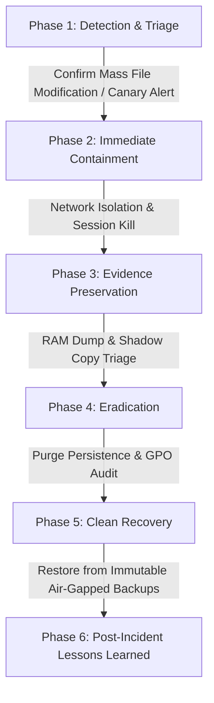

# Incident Response Playbook 01: Enterprise Ransomware Containment

**Framework Alignment:** NIST SP 800-61 Rev 2 (Computer Security Incident Handling Guide)  
**Classification:** Enterprise SecOps Standard Operating Procedure (SOP)  
**Objective:** Rapid triage, network isolation, cryptographic preservation, and eradication of double-extortion ransomware.

---

## 1. Lifecycle Overview



---

## 2. Phase 1: Detection & Triage (T + 0 to 15 Minutes)

### Primary Trigger Indicators
- **EDR High-Severity Alerts:** Mass file renaming, shadow copy deletion commands (`vssadmin delete shadows /all /quiet`, `wbadmin delete catalog`).
- **File Integrity Monitoring (FIM):** Canary file alert triggered on network shares (e.g., `!RECOVER_YOUR_FILES.txt`).
- **Network Telemetry:** Spike in high-frequency internal SMB writes across port 445.

### Immediate Action Checklist
- [ ] Determine patient zero hostname and IP address via EDR console.
- [ ] Identify the ransomware family (LockBit, BlackCat/ALPHV, Akira) via ransom note markers or file extension.
- [ ] Do **NOT** reboot infected systems (rebooting destroys volatile memory containing cryptographic keys and injected processes).

---

## 3. Phase 2: Immediate Containment (T + 15 to 45 Minutes)

### 3.1 Network Isolation Protocols
1. **EDR Host Isolation:** Trigger network isolation directly via CrowdStrike / SentinelOne console (preserves cloud management connection while severing all internal and external communication).
2. **Switch Port Shutdown (Physical/VLAN):** If host EDR is unresponsive, administratively disable the corresponding switch port or drop the infected host into an isolated quarantine VLAN.
3. **Emergency SMB Block:**
   ```powershell
   # Disable SMBv1 and close file shares immediately across Tier-1 servers
   Set-SmbServerConfiguration -EnableSMB1Protocol $false -Force
   Set-NetFirewallRule -DisplayName "File and Printer Sharing (SMB-In)" -Enabled False
   ```

### 3.2 Identity & Active Directory Lockdown
- [ ] Disable compromised user accounts and reset Kerberos `krbtgt` password twice (48 hours apart) to invalidate all forged Golden Tickets.
- [ ] Force terminate all active Azure AD and VPN sessions.

---

## 4. Phase 3: Evidence Preservation & Forensics

```bash
# Capture volatile memory prior to remediation
winpmem.exe -o C:\forensics\infected_host_ram.raw

# Extract event logs for analysis
wevtutil epl Security C:\forensics\Security_Log.evtx
wevtutil epl Microsoft-Windows-Sysmon/Operational C:\forensics\Sysmon_Log.evtx
```

---

## 5. Phase 4 & 5: Eradication & Recovery

1. **Verify Backup Integrity:** Confirm backup storage was not compromised. Validate air-gapped immutable S3 bucket or offline tape backups.
2. **Scan Before Restoration:** Ensure rebuilt operating systems are patched against known CVEs before rejoining the domain.
3. **Validate Decryption:** If keys are recovered from memory or through official law enforcement decryptors (NoMoreRansom.org), test decryption in an isolated sandbox.
